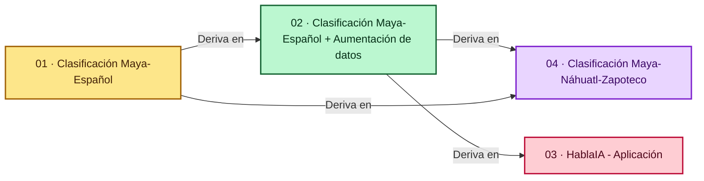

# Identificación de Lenguas Indigenas

Sistema de investigacion para reconocer lenguas indigenas (maya,
nahuatl y zapoteco, junto con espanol) a partir de audio, orientado a
contextos de emergencia donde identificar la lengua del hablante es critico.
El enfoque convierte grabaciones en espectrogramas y los clasifica con redes
convolucionales preentrenadas. El repositorio incluye cuatro proyectos:
Clasificación de Maya-Español, Clasificación de Maya-Español + Aumento de datos, Clasificacion
de Maya-Nahuatl-Zapoteco y la aplicación movil HablaIA.

## Mapa de proyectos

| Proyecto | Contenido |
|---|---|
| [`01 Clasificación de Maya-Español`](01-clasificacion-maya-espanol/) | Proyecto Origen: clasificacion binaria por pares de lenguas con espectrogramas y CNN |
| [`02 Clasificación de Maya-Español + Aumento de datos`](02-clasificacion-maya-espanol+aumento-de-datos/) | Aumento de datos y modelos ligeros para maya-español |
| [`03 HablaIA Aplicación`](03-HablaIA-aplicacion/) | Aplicacion movil: graba audio y clasifica la lengua en el dispositivo |
| [`04 Clasificación Maya-Nahuatl-Zapoteco`](04-clasificacion-maya-nahuatl-zapoteco/) | Clasificador de maya, nahuatl y zapoteco |

## Datos

El trabajo completo utiliza audios y espectrogramas con distintos niveles de acceso. Estas son las ubicaciones de cada conjunto:

| Conjunto | Ubicación | Detalle |
|---|---|---|
| Audios públicos | [`01-clasificacion-maya-espanol/datos/audios/`](01-clasificacion-maya-espanol/datos/audios/) | Audios originales y clips del proyecto 01, separados por lengua. |
| Espectrogramas del proyecto 01 | [`01-clasificacion-maya-espanol/datos/spectrograms/`](01-clasificacion-maya-espanol/datos/spectrograms/) | Espectrogramas generados a partir de los audios anteriores, con las variantes sin silencio y por clip. |
| Espectrogramas del proyecto 02 | [`02-clasificacion-maya-espanol+aumento-de-datos/datos/spectograms/`](02-clasificacion-maya-espanol+aumento-de-datos/datos/spectograms/) | Copia parcial de los espectrogramas sin silencio: 392 de maya y 546 de español. |
| Audios restringidos | [`Audios INALI`](https://drive.google.com/drive/folders/1usv2-G1POv_V0xXvwwGHEjBLB5P7yJ5y?usp=sharing) | Unidad de Google Drive; requiere autorización. No están incluidos aquí. |
| Audios del proyecto 04 | [Google Drive](https://drive.google.com/drive/folders/1TQwCDDDMf2kuVycOb_rD0mIOlI_0xtux?usp=sharing) | Audios de entrenamiento del clasificador maya-náhuatl-zapoteco. |
| Espectrogramas del proyecto 04 | [Google Drive](https://drive.google.com/drive/folders/1RncuOhLhO8K3MuJ6cTW3n1RTG9bSAB3l?usp=sharing) | Espectrogramas de entrenamiento del clasificador maya-náhuatl-zapoteco. |

